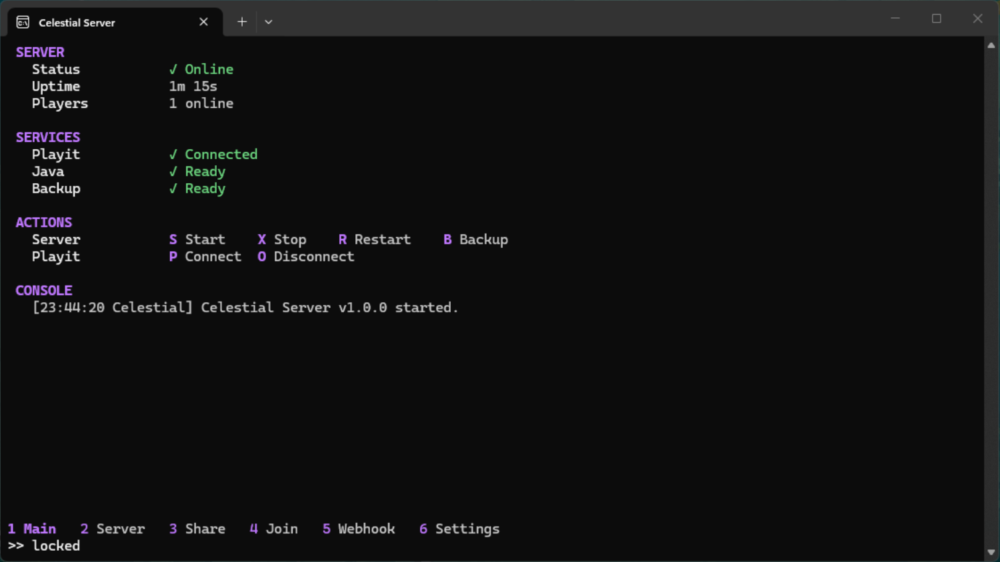

<h1 align="center">Celestial Server</h1>

<p align="center"><strong>A clean, fast terminal app for managing your Minecraft Java server.</strong><br>
Built with Rust. Start servers, manage world backups, and share access with trusted managers.</p>

<p align="center">
  <a href="https://github.com/kradengdeng/celestial-server/releases"></a>
  
  
  
  
</p>

<p align="center">
  
</p>

<p align="center">
  <a href="https://github.com/kradengdeng/celestial-server/releases">Download</a> ·
  <a href="#controls">Controls</a> ·
  <a href="#settings">Settings</a> ·
  <a href="#updates">Updates</a>
</p>

## Features

| Feature | Description |
| --- | --- |
| Terminal interface | Colorful, keyboard-driven TUI for Windows and Linux. |
| Server controls | Start, stop, restart, and run console commands. |
| Live monitoring | Follow logs, players, uptime, and system resource usage. |
| World backups | Create backups while the server is stopped; set how many to keep. |
| Manager access | Share one-time invite codes with up to five trusted managers. |
| Permissions | Grant managers specific actions and block selected console commands. |
| Remote join | Reconnect to saved sessions from the Join tab. |
| Playit and webhooks | Configure a Playit tunnel and Discord-compatible notifications. |
| Required updates | Check the official GitHub repository at startup and install new releases. |

## Install and run

Download the latest release from [GitHub Releases](https://github.com/kradengdeng/celestial-server/releases), extract it, and run `celestial-server.exe` from a terminal. On first launch, follow setup to select your Minecraft server folder and Java executable.

On Linux, download the Linux release asset and run:

```sh
chmod +x celestial-server
./celestial-server
```

### Requirements

- Windows 10/11 or a supported Linux distribution.
- Java compatible with your Minecraft server version.
- A Minecraft Java server `.jar` file.
- For manager access over the internet, a TCP tunnel forwarding to the configured share port (Playit is supported).

## Quick start

1. Launch Celestial and choose your Minecraft server folder.
2. In **Settings**, check the server `.jar` and Java path.
3. Accept the Minecraft EULA in the server folder.
4. Press **S** on **Main** to start the server.
5. Open **Server** to follow logs; press `/` to type a console command.
6. Stop the server, then press **B** on **Main** to create a world backup.

## Share access with managers

1. Configure a TCP tunnel to forward to `127.0.0.1:25580` (or the share port shown in Settings). Set the public endpoint in **Share address**.
2. Open **Share** and give a trusted manager the endpoint and one-time invite code. Codes rotate automatically; **F6** creates a new one.
3. On the manager's computer, open **Join**, press **Enter**, and enter the endpoint and invite code when prompted.
4. Managers start with no permissions. Select a manager and press **F4** to grant the actions they need.

Hosts can pause access, extend a manager's time, or revoke access. Managers cannot create backups.

## Controls

| Action | Keys |
| --- | --- |
| Switch tabs | `1`–`6`, `F1`–`F6`, `Tab` / `Shift+Tab` |
| Start / stop / restart | `S` / `X` / `R` |
| Create backup | `B` |
| Connect / disconnect Playit | `P` / `O` |
| Enter server command | `/`, then `Enter` to run or `Esc` to cancel |
| Scroll logs | `Page Up` / `Page Down`; `End` returns to the bottom |
| Edit manager permissions | `F4` on Share |
| Create invite code | `F6` on Share |
| Quit | `Ctrl+C` |

Tab numbers and function keys work across keyboard layouts.

## Settings

Celestial settings cover server folder and jar, Java, RAM limits, restart behavior, Playit, manager access, invite rotation, share address, backup retention, and interface accent color. Settings save automatically. The release update source is locked to `kradengdeng/celestial-server`.

## Updates

Celestial checks the `kradengdeng/celestial-server` GitHub releases on startup. If a newer version is available, you must install it before continuing. When the release provides a `.sha256` checksum, the updater verifies the download. Updates preserve Celestial data and restart the app after installation. An internet connection is required.

## Data and troubleshooting

Celestial stores its configuration, manager records, join details, audit log, and backups under:

- Windows: `%APPDATA%\CelestialServer` (backups are in its `backups` folder).
- Linux: `$XDG_CONFIG_HOME/CelestialServer` or `~/.config/CelestialServer` (backups are in `backups`).

Set `CELESTIAL_DATA_DIR` to use a different location. Keep this folder private because it can contain access credentials and server management information.

- **Java not found:** Install a compatible Java version and set its executable path in Settings.
- **Port already in use:** Stop the other process using the Minecraft server port or change it in `server.properties`.
- **Managers cannot connect:** Check the TCP tunnel, local share port, and public address.
- **Keyboard input issues:** Set `CELESTIAL_INPUT_LOG=1` before launch; received key events are written to `input.log` in the data folder.

## License

Celestial Server is proprietary software and is not distributed under an open-source license. No open-source license is granted by this repository. For licensing questions, contact [@kradengdeng](https://github.com/kradengdeng).

## Credits

Made by [@kradengdeng](https://github.com/kradengdeng).
